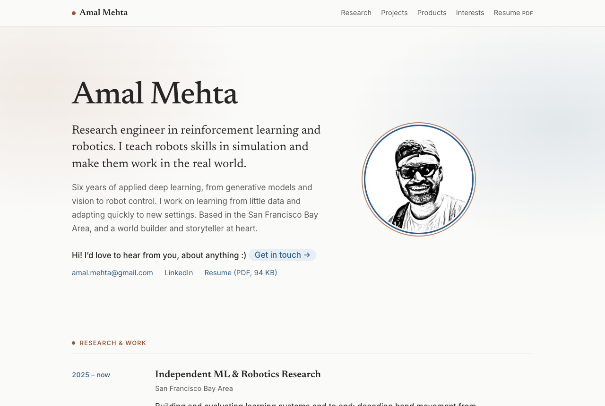
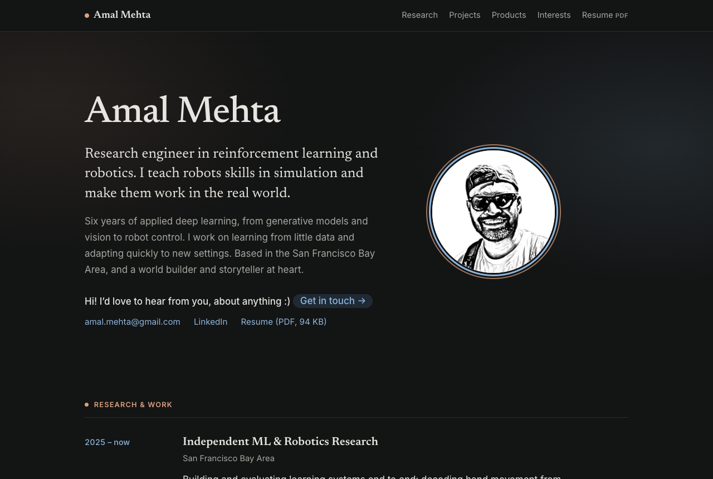

# Portfolio Website

My personal website. The profile has research and work, eight projects, three products, two class writeups and a live skills list. Pages of its own cover what I'm thinking about, my live interests, travel and values. Two extras are hidden: a Pong game on the Travel page, and a replay of Messi's 2011 solo goal behind "soccer tournaments" on the profile.

**Live:** [amalmehta.github.io/PortfolioWebsite](https://amalmehta.github.io/PortfolioWebsite/)

| Light | Dark |
|---|---|
|  |  |

## Links

- [Instructions](docs/INSTRUCTIONS.md): preview locally, edit content, rebuild the resume, publish
- [System design](docs/SYSTEM-DESIGN.md): how it's built, decisions, limits
- [File structure](docs/FILE-STRUCTURE.md): what's where
