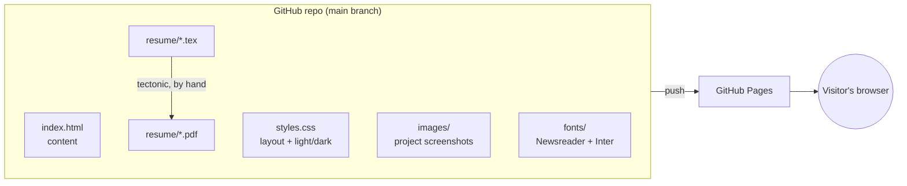

# System design

Back to the [README](../README.md) · [Instructions](INSTRUCTIONS.md) · [File structure](FILE-STRUCTURE.md)

## Overview

A small static site: a profile page plus pages for Things I'm thinking about, Live interests and Travel, one stylesheet, a few small scripts (the two hidden extras, the tile motion, and a clip loader that waits until a card has a clip), screenshots and drawings, a few PDFs and a resume. GitHub Pages serves it as-is. There is no build step or framework.

## Components

| Part | Job |
|---|---|
| `index.html` | The profile. A sticky header, an intro with a hello line and contact links, a Featured projects section of the four most vetted research projects as large cards (image, one-sentence hook, stack, code and a demo where one exists), five research and work entries laid out as a timeline (dates on the left, a summary, a drawing and a tags line), then More projects, a short list of supporting builds with public code, two selected writeups (class reports) in the timeline layout, each linking its PDF in `papers/`, a dated Skills list (a superset of the resume's, checked by the tests), a Musings section hidden until its first note, and an Outside work paragraph whose "soccer tournaments" hides the Messi replay. |
| `thinking.html` | "Things I'm thinking about": a separate page of numbered open questions, sharing the header, footer and stylesheet. Thoughts link to the project cards and entries they mention. Linked from Live interests and every page's footer. |
| `photos.html` | Travel: opens with Places I'm going (upcoming trips with their dates, each with a drawing; Chamonix first), then Places I'd like to go, six original drawings of an iconic spot from each place (`images/places/`, drawn by `tools/draw-places.py`, labelled as drawings), then a Photos section for captioned photos (place and year, plus a line about the moment), still "coming soon". Photos go in `images/photos/` as WebP with location data stripped. One column on phones up to three on wide screens. Linked from Live interests and every page's footer. |
| `messi.js` | A second hidden extra. "soccer tournaments" in the profile's Outside work is a button that looks like plain text; it opens a dialog with a canvas replay inspired by Messi's solo goal against Real Madrid in the 2011 Champions League semi-final: dots on half a pitch, a dotted trail, defenders who close him down and fall away, the keeper diving the wrong way, and "Goal!". It's an approximation, not tracking data, and says so. With reduced motion it shows the final picture. Without JavaScript the words stay plain text. |
| `pong.js` | A hidden Pong game. On the Travel page (`photos.html`), a small skier glides down the Hokkaido drawing (it stands still with reduced motion); clicking it opens a dialog with a canvas game against the mountain, first to 5, played with the mouse, touch or arrow keys. Physics runs on a fixed 120 Hz clock and drawing blends the last two steps, so it moves the same at any frame rate; paddle hits are checked along the ball's path, so a fast ball can't slip through. The skier stays hidden without JavaScript. |
| `values.html` | What I try to live by: Values (numbered), Beliefs (two tabs, What I believe currently and a Let go archive, switched by `beliefs.js`; without JavaScript, or on paper, both show), Inspiration and Things I care about. Inspiration and Things I care about say "Coming soon." until their first entry. It's linked only from the profile footer, as a muted "Values" link, so it's there for those who look without competing with the work. |
| `interests.html` | Live interests: what's current, as tiles. Hobbies and Curious about are grids of tiles with line icons that move on hover, and once as they scroll into view or are tapped (`tiles.js`); some tiles link to the page or entry they're about. A Books section (Reading now, Read with stars and a short review, Want to read; built from `books.json` by `tools/make-books.py`, hidden until the first book) and a My art gallery that waits hidden until its first piece. It ends with links to Things I'm thinking about and Travel. Entries that stop being current are removed rather than kept. Linked in the header of every page. |
| `email.js` | On every page. In the intro's contact list it also adds a small Copy button beside the address, for visitors with no mail app set up. The email address is written into the HTML as "amal.mehta [at] gmail.com" with its two halves in `data-` attributes, so bots harvesting raw pages don't get it; the script turns each into a normal mailto link. Without JavaScript the link goes to the contact form. The address is left out of the structured data too. |
| `tiles.js` | Plays each Live interests tile's icon motion once as it scrolls into view, and again on tap, since phones have no hover. Reduced motion turns it off in the stylesheet. |
| `papers/` | PDFs linked from the site: the Hybrid Robotics Lab research project report and the two school project reports. The melanoma paper links to SPIE instead. |
| `styles.css` | Typography (Newsreader serif for headings, Inter for body), a 1040 px column, a two-column project layout above 820 px that stacks on phones, and colour tokens that switch with the system's dark mode: a blue accent (dates, research chips, links) and a terracotta one (section labels, project chips), plus a faint two-colour wash behind the intro. Accent text on its chip background is at least 4.5:1 contrast in both themes. |
| `_archive/` | The blog, archived. Pages skips folders starting with `_`, so it's kept in the repo but not published. `_archive/README.md` says how to restore it. |
| `images/portrait.jpg` | The intro portrait: a pencil sketch beside the name on desktop, above it on phones. |
| `images/` | One screenshot per project and product, taken from each one's own repo; the cards show a 960 px WebP copy (which also becomes the poster once a card has a clip). The four lab entries show SVG drawings (`physicsai.svg`, `robot-soccer.svg`, `vip-lab.svg`, `brain-emd.svg`) drawn by `tools/draw-research-art.py`. Also the link-preview images, one per public page. |
| `assets/media/` | Where real project clips go once recorded; see its README. The placeholder loops were removed, since a looped screenshot looked the same as the still but cost 65–200 KB each. |
| `media.js` | Lazy-loads the clips: each `<source>` holds its file in `data-src`, and the script fills in `src` when the clip is within 200 px of the screen, pauses clips scrolled away, and lets a click pause or resume one. With no JavaScript or with reduced motion on, the poster shows instead. |
| `resume/` | LaTeX source and the PDF it builds. |

## Main flows

- **Visiting**: the browser loads the HTML, the stylesheet and the fonts; images below the fold load lazily. The header links to Projects (Featured), Research, Interests and the resume (Profile and Projects instead on the other pages). The link for the page you're on is underlined and marked for screen readers; Things I'm thinking about and Travel mark Interests, and Values marks Profile, since that's where they're linked from. Below 600 px it keeps three links and drops Projects: on the profile Featured starts right below the intro while Research is several screens down, and on the other pages Profile already leads to the projects. Featured projects come first on the profile, so a visitor sees the strongest work, each with a demo to try and its source, before the timeline.
- **Updating**: edit `index.html` or swap an image, preview with a local server, push. Pages redeploys.
- **Resume**: edit the `.tex`, rebuild with Tectonic, commit the PDF.

## Where data lives

All in the repo. Nothing is stored or collected on the site: no analytics, cookies or forms.

## Key decisions

- **Plain HTML over a framework or site generator.** One page with eleven cards doesn't need one, and anyone can edit it. The cost is that repeated card markup is copied by hand.
- **No code links for private projects.** Most projects are in private repos, so their cards have a write-up and screenshot only. Neural Signal ML and Post Training Lab link to their public repos, AlphaGo Lite to its in-browser demo and Sports Pred to its live site.
- **Plain-language project descriptions.** Each card says what the project does and why it's interesting before naming techniques; the techniques go in the small tags line.
- **Resume built from source.** The resume PDF is built from LaTeX in `resume/`, so it can be edited and rebuilt in one step. It lists email, LinkedIn and this site, and no phone number.
- **Link preview.** Open Graph tags and a 1200×630 image per page: `images/og.png` for the profile (a render of the intro) and `og-interests.png`, `og-travel.png`, `og-thinking.png` and `og-values.png` for the other pages, each captured from the top of its page with headless Chrome in light mode with the sticky header hidden. They give a title, summary and image when a link is pasted into email, Slack or an applicant tracker. Recapture one when the top of its page changes.
- **Not an application.** This is a static personal site, so it has no Mac app, feedback tab or settings panel.
- **A drawn portrait.** The intro portrait is a pencil sketch made from a photo with the Headshot Generator project's own image code. The source photo is not in the repo.
- **The site holds more than the resume.** The resume points to this site for details, so everything on it has a matching entry here, while the site also shows projects the resume has no room for. Interests outside work sit in a short paragraph at the bottom and on Live interests, not in the work timeline.
- The Neuroimaging Platform screenshot shows the MNI ICBM152 template, credited on the card as its README does.
- **Clips as muted MP4 loops, not GIFs.** `<video autoplay muted loop playsinline preload="none">` with a poster is a fraction of a GIF's size and plays inline on phones. Clips are lazy-loaded by `media.js` because `autoplay` would otherwise start downloading every clip on page load. No project has a clip yet, so the cards show still images and `media.js` stays off the page until one does.
- **Drawings for the research entries.** There's no footage to show from past lab work, and stock photos either showed other people or weren't the real robot, so each research entry has an original drawing in the site's colours. The numbers and outlines in them are illustrative, not results.
- **Follows the system's light/dark setting** with no manual toggle, to keep the page minimal. In dark mode, screenshots and drawings are dimmed slightly so they don't glare, and brighten on hover.
- **Respects reduced motion.** With it on, nothing lifts or animates on hover, scroll-in or tap, and in-page links jump instead of gliding (tested).
- **Prints as a short document.** A print stylesheet hides the header, pictures and decorations, sets print-sized type, keeps dates beside entries and keeps each entry or card on one page: the profile prints in about 5 pages instead of 18. On paper, links print the address they go to, and the Live interests tiles print without their fade-in.

## How it's tested

Automatically, with `python3 -m unittest discover tests` (standard library only; see [Instructions](INSTRUCTIONS.md#run-the-tests)). The tests check that:

- every local link, image and anchor resolves, and nothing links into `_archive/`;
- each image's `width`/`height` match the file, and any clip is a muted, lazy-loaded loop under 2 MB that comes with `media.js`;
- Featured comes first with three or four complete cards, each with an AVIF image, a one-sentence hook and its public code (and a live demo where one exists), and every project on the profile links public code;
- the four named research entries have an image;
- text and chip colours reach 4.5:1 contrast in both themes;
- the Skills list contains every resume skill and carries an "updated" date;
- hidden sections (Musings, Books, My art, Writings) are hidden exactly while they're empty, and Values' Inspiration and Things I care about say "Coming soon." exactly while they're empty;
- every profile entry and thought has a unique anchor, LinkedIn links carry `rel="me"`, and Live interests' next trip matches one on Travel;
- each `papers/` link's stated size matches its file, and each public page has its own 1200×630 link preview;
- the hidden Pong and Messi extras are wired up;
- the resume source has no phone number and the built PDF is one page (counted with the standard library).

Also by hand, in a browser against a local server:

- every image loads;
- no horizontal scroll at 390 px (phone) or 1280 px (desktop);
- light and dark modes both read well;
- the hidden extras, the tiles' motion and the link landings work, on desktop and a 375 px touch phone.

## Known limits

- Fonts are self-hosted in `fonts/` (Latin and Latin Extended subsets of the variable Newsreader and Inter, SIL Open Font License). Characters outside those subsets fall back to Georgia and the system sans-serif.
- Screenshots and clips go stale as the projects change; refresh them by hand.
- No project has a real clip yet; cards show their screenshot until one is recorded (listed in `assets/media/README.md`).
- Neural Signal ML quotes R² on the NLB benchmark split (0.75 vs 0.55), as its figure does; its README headlines the blocked cross-validation numbers (0.80 vs 0.56).
- The Sim to Real Drone Bench image comes from its stand-in drone, since no real Crazyflie flight has been flown yet; the card says so.
- The resume build uses an absolute path to a macOS system font, so it rebuilds on a Mac only.
